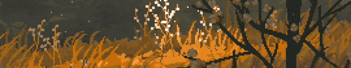
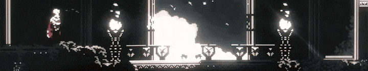

  

<h1 align="center">CloudTop Builds</h1>

  Independent studio making Unity editor tools, game dev utilities and small games.

  
  

 

## Stack

  
  
  
  
  
  
  
  
  
  

## Activity

  
  

  

## Support the studio

If our tools save you time, you can support development on Ko-fi. It pays for assets, software licenses and more hours spent building.

  

 

  

  

